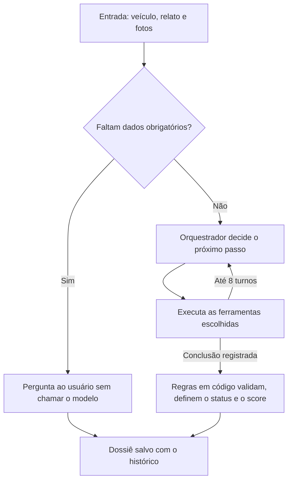

# Vencar API

Backend da Vencar, criado para o AKCIT CAMP. Um agente de IA analisa dados do veículo, relato e fotos, e monta um dossiê técnico rastreável com o Score Vencar.

> **Estado atual:** protótipo. O score é provisório, o login usa tokens de teste e o plano gratuito do Gemini serve apenas para dados de teste. Veja [Limitações](#limitações).

O frontend está em [vencar-app](https://github.com/vencar-hackathon-akcit/vencar-app).

## Como rodar

**Pré-requisitos:** Python 3.12 ou superior e uma chave do [Google AI Studio](https://aistudio.google.com/apikey).

```bash
python3 -m venv .venv
.venv/bin/pip install -e ".[dev]"
cp .env.example .env
```

Preencha `GOOGLE_API_KEY` no `.env` e inicie o servidor:

```bash
.venv/bin/uvicorn --factory vencar.main:create_app --port 8000
```

| Endereço | Conteúdo |
|---|---|
| `http://localhost:8000/docs` | Documentação interativa da API |
| `http://localhost:8000/test-ui/` | Página simples para testar o agente |
| `http://localhost:8000/health` | Verificação do servidor |

## Configuração

| Variável | Padrão | Descrição |
|---|---|---|
| `VENCAR_PROVIDER` | `google` | Provedor do modelo: `google` ou `anthropic` |
| `GOOGLE_API_KEY` | | Chave do Gemini |
| `ANTHROPIC_API_KEY` | | Chave do Claude, cobrada à parte de planos como o Pro |
| `VENCAR_MODEL` | `gemini-3.5-flash-lite` ou `claude-opus-5-5` | Modelo principal |
| `VENCAR_FALLBACK_MODEL` | `gemini-3.1-flash-lite` no Google, nenhum na Anthropic | Modelo usado se o principal falhar |
| `VENCAR_DATA_DIR` | `data` | Pasta do banco e das fotos |
| `VENCAR_API_TOKENS` | tokens de teste | Pares `token:usuario` separados por vírgula |
| `VENCAR_CORS_ORIGINS` | `http://localhost:3000` | Origens liberadas, separadas por vírgula |

## Como o agente funciona



**O modelo decide:** o orquestrador escolhe quais ferramentas usar, com quais fotos e em que ordem.

| Ferramenta | O que faz |
|---|---|
| `analyze_bodywork` | Aciona o `agente_funilaria`: lataria, pintura e estrutura visível |
| `analyze_interior` | Aciona o `agente_tapecaria`: bancos, estofamento e acabamento interno |
| `get_vehicle_history` | Consulta avaliações anteriores da mesma placa e do mesmo usuário |
| `submit_conclusion` | Registra a posição final do orquestrador |

**O código decide:** as regras têm a palavra final sobre o resultado do modelo.

- Descarta avarias e hipóteses sem evidência válida.
- Rejeita fotos que nenhum especialista reconheceu como carro. Hatch, sedan, SUV e picape são aceitos.
- Transforma a divergência entre a foto e o veículo informado em um único conflito.
- Define o status final e calcula o score.
- Exige validação humana em todo dossiê.

Quando o usuário responde a uma pergunta, o agente roda de novo com a nova evidência.

### Status

| Status | Significado |
|---|---|
| `processing` | O agente está trabalhando |
| `completed` | Avaliação concluída, sujeita a validação humana |
| `needs_input` | Falta dado, a foto não serve, há conflito ou o agente precisa de uma resposta |
| `inconclusive` | Não há evidência suficiente para avaliar |
| `failed` | A execução falhou, com o motivo em `error` |

### Score Vencar

O score vai de 0 a 100 e só aparece em avaliações `completed`.

| Faixa | Nível |
|---|---|
| 0 a 40 | `attention` |
| 41 a 70 | `regular` |
| 71 a 100 | `very_good` |

| Categoria | Peso |
|---|---|
| Estrutural | 30 |
| Mecânica | 30 |
| Elétrica | 10 |
| Estética | 15 |
| Documental | 15 |

Cada categoria recebe uma nota de 0 a 10 baseada principalmente na avaria mais grave, e avarias de baixa confiança não reduzem a nota. Categorias sem evidência ficam como não avaliadas e não entram na média.

Por foto, os especialistas só avaliam estética e estrutura visível, ou seja, no máximo 45% do peso. Por isso `isPartial` indica cobertura parcial. Os pesos e as notas são valores provisórios (`isProvisional: true`) até serem validados por um especialista automotivo.

## API

Todas as rotas abaixo exigem `Authorization: Bearer <token>`. Em desenvolvimento, use `teste-usuario-a` ou `teste-usuario-b`. Os dois usuários não acessam os dados um do outro.

| Método | Rota | Descrição |
|---|---|---|
| `POST` | `/api/v1/assessments` | Cria a avaliação e inicia o agente (`multipart/form-data`) |
| `GET` | `/api/v1/assessments` | Lista as avaliações do usuário |
| `GET` | `/api/v1/assessments/{id}/status` | Retorna o progresso, para polling |
| `GET` | `/api/v1/assessments/{id}` | Retorna a avaliação, o dossiê e o histórico |
| `POST` | `/api/v1/assessments/{id}/answers` | Registra a resposta e executa o agente de novo |
| `GET` | `/api/v1/assessments/{id}/photos/{photoId}` | Retorna uma foto da avaliação |

Campos de criação: `make`, `model`, `year`, `plate`, `mileage`, `region`, `usage`, `description` e `photos` (até 10, com até 15 MB cada). São obrigatórios marca, modelo, ano, placa e ao menos uma foto. Se faltarem, a avaliação termina como `needs_input`.

Campos de resposta: `answer`, `make`, `model`, `year`, `plate` e `photos`.

### Fluxo com polling

1. Envie `POST /api/v1/assessments` e guarde o `id`.
2. Chame `GET /api/v1/assessments/{id}/status` e aguarde `pollAfterMs` entre as chamadas.
3. Quando `isFinished` for `true`, busque o resultado em `GET /api/v1/assessments/{id}`.

```json
{
  "id": "a5a007729dfc440f9286bf84c726efd6",
  "status": "processing",
  "stage": "analyzing",
  "lastAction": "analyze_bodywork",
  "isFinished": false,
  "pollAfterMs": 2000,
  "error": null,
  "updatedAt": "2026-10-31T12:00:00+00:00"
}
```

Os estágios são `received`, `analyzing`, `validating` e `finished`.

### Erros

Todos os erros usam o mesmo formato. Erros de validação também trazem `fields`.

```json
{ "code": "assessment_not_found", "message": "Avaliacao nao encontrada." }
```

| HTTP | `code` |
|---|---|
| 401 | `unauthorized` |
| 404 | `assessment_not_found` ou `http_error` |
| 409 | `assessment_busy` |
| 413 | `too_many_photos` |
| 415 | `invalid_photo` |
| 422 | `validation_error` |
| 500 | `internal_error` |
| 502 | `agent_failure` |

## Arquitetura

O projeto segue a arquitetura hexagonal: `domain` e `application` não dependem de FastAPI, SQLite ou LangChain.

```text
src/vencar/
├── domain/              Entidades, regras do dossiê, score, progresso e erros
├── application/
│   ├── ports.py         Interfaces de repositório, armazenamento e agente
│   └── use_cases/       Criar, executar, responder e consultar avaliações
├── adapters/
│   ├── api/             Controllers, schemas e tratamento global de erros
│   ├── agents/          Grafo LangGraph, orquestrador, especialistas, prompts e modelos
│   ├── database/        Repositório SQLite
│   └── storage/         Fotos em disco
├── utils/               Funções genéricas, sem regras da Vencar
├── config.py            Configuração
└── main.py              Conexão entre as partes
test_ui/                 Página de teste
tests/                   Testes por área
```

Para adicionar um especialista, inclua o nome em `SpecialistName` e a definição em `adapters/agents/specialist_catalog.py`.

**Histórico:** cada decisão e chamada de ferramenta fica em um registro somente de inserção e encadeado por hash. A resposta informa `historyIntact`, que indica se o encadeamento continua válido. Isso torna alterações detectáveis, mas não as impede para quem controla o banco.

## Desenvolvimento

```bash
.venv/bin/python -m pytest -q
```

```bash
.venv/bin/ruff check .
```

```bash
.venv/bin/ruff format .
```

Os testes usam modelos simulados, então não gastam cota nem medem a qualidade da análise de um modelo real.

## Limitações

- **Score:** a escala é provisória e mecânica, elétrica e documentação não são avaliadas.
- **Precisão:** o agente foi testado com poucas fotos públicas, e o resultado pode variar entre execuções.
- **Dados:** no plano gratuito do Gemini, o Google pode usar o conteúdo enviado para melhorar seus produtos, e revisores humanos podem lê-lo. Envie apenas dados de teste.
- **Identidade do veículo:** uma correção do usuário pode ser aceita se a foto não a contradisser claramente.
- **Histórico do veículo:** é limitado ao mesmo usuário e ainda não acompanha o carro entre proprietários.
- **Autenticação:** usa tokens de teste, sem contas reais.
- **Infraestrutura:** SQLite, fotos em disco e tarefas em segundo plano atendem a uma demonstração, não à produção. Uma execução em andamento se perde se o servidor parar.
- **Página de teste:** `/test-ui/` é servida sempre que a pasta `test_ui/` existe. Remova-a antes de ir para produção.
- **Consultas ao modelo:** o tempo de uma avaliação depende da carga do provedor. Se o modelo principal e o reserva estiverem indisponíveis, a execução pode terminar sem resultado.
